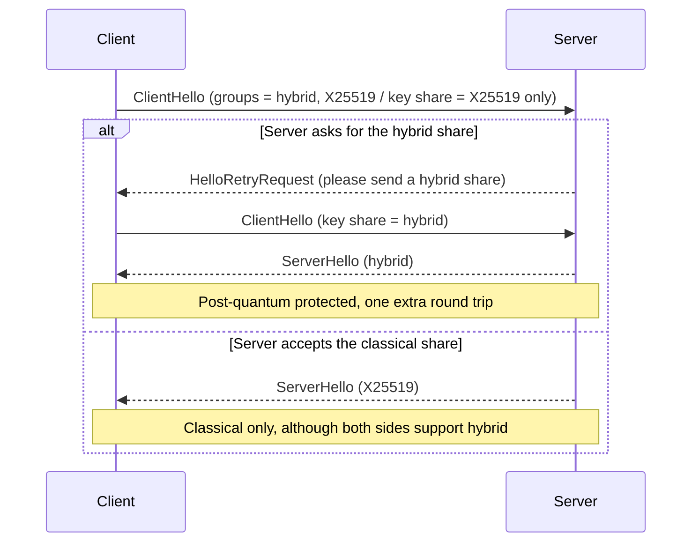
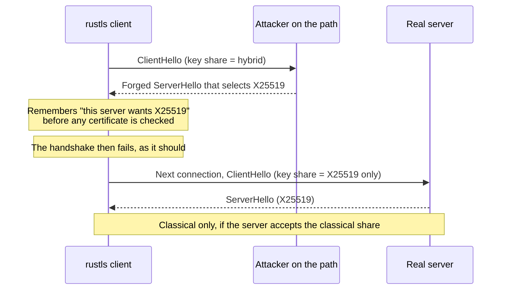
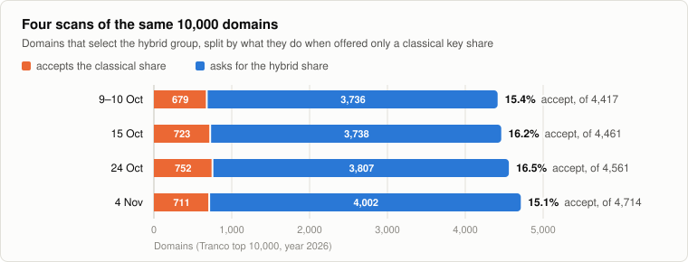
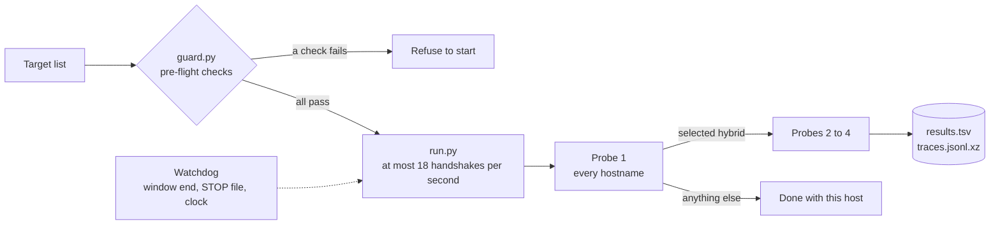

# When post-quantum TLS quietly falls back to classical

Browsers and TLS libraries now enable hybrid post-quantum key exchange (X25519MLKEM768) by default.
My question was simple: if both the client and the server support it, can a connection still end up
with classical key exchange only?

It can. This repository holds what I found and the scanner I wrote to measure how common it is.

## Background in three sentences

In TLS 1.3 a client lists the key-exchange groups it supports and, separately, sends key shares for
some of them. If the client lists the hybrid group but only sends an X25519 share, the server can
either ask for the hybrid share (a HelloRetryRequest, one extra round trip) or simply accept X25519.
The standard allows both, so the outcome depends on the library and how it is configured.

## What I found

**1. A downgrade bug in rustls.**
One forged ServerHello, processed before the server's certificate was checked, made the client send
only a classical key share on later connections to the same server name. I reported it privately and
the maintainers fixed it in rustls 0.23.46
([GHSA-w44r-93j7-qv28](https://github.com/rustls/rustls/security/advisories/GHSA-w44r-93j7-qv28),
CVE-2026-123611, severity low).

**2. Many servers accept the classical share.**
In a scan of the Tranco top 10,000 domains, 4,461 selected the hybrid group when offered both shares.
When offered only the classical share, 16.2% of them completed the handshake on X25519 without asking
for the hybrid one. Four scans over several weeks gave 15.1% to 16.5%.

<picture>
  <source media="(prefers-color-scheme: dark)" srcset="docs/four-scans-dark.svg">
  
</picture>

The share is highest among the most popular sites.

<picture>
  <source media="(prefers-color-scheme: dark)" srcset="docs/by-rank-dark.svg">
  
</picture>

Most of these domains sit behind two large CDNs. I notified both, and one has since changed its TLS
library so that the server asks for the hybrid share. They stay unnamed here until the work is published.

<picture>
  <source media="(prefers-color-scheme: dark)" srcset="docs/by-operator-dark.svg">
  
</picture>

**3. The cause is in library defaults and configuration.**
In a local testbed, a server accepts the classical share when it runs:

- OpenSSL with a colon-separated group list, which ranks both groups equally;
- an OpenSSL release affected by CVE-2026-2673, where a list containing `DEFAULT` loses its order;
- wolfSSL with default settings.

**4. It already happens for mail.**
Postfix 3.11 sends only the classical share by default when it delivers mail. Against any server from
point 3, the connection is classical even though both ends support the hybrid group.

**5. Asking for the hybrid share is cheap.**
The extra round trip cost about 55 ms on average from our campus network.

## How the measurement works

Each hostname gets at most four TLS 1.3 handshakes. The first one goes to everyone; the other three
only go to servers that selected the hybrid group.

| Probe | Groups listed | Shares sent | Question |
|---|---|---|---|
| 1 | hybrid, classical | both | Does the server support the hybrid group? |
| 2 | hybrid, classical | classical | Does it accept the classical share, or ask for the hybrid one? |
| 3 | classical, hybrid | classical | Whose preference order does it follow? |
| 4 | classical, hybrid | both | Whose preference order does it follow? |

Results are read from the recorded handshake messages, not from the client's summary line, because
the summary does not show a HelloRetryRequest. Every connection closes right after the handshake.

## The scanner

The code is in [`scanner/`](scanner/). It is plain Python 3 (standard library only, `asyncio`) and
drives the OpenSSL 3.5 command-line client.

- **Three protocols:** HTTPS, SMTP with STARTTLS, and QUIC (HTTP/3).
- **Gentle by design:** at most 18 handshakes per second, four per hostname, no retries, no
  application data, and an opt-out list that is checked before every probe.
- **A guard in front of every run** ([`guard.py`](scanner/guard.py)): it checks the time window, the
  source address, clock sync, free disk and file hashes before starting, then watches the run and
  stops it at a kill switch or at the end of the window. Interrupted runs can resume without probing
  a host twice.
- **65 offline tests** that run in an isolated network namespace against local test servers:
  `bash scanner/run_tests.sh`.

A typical night: about 230,000 handshakes to 100,000 hostnames in roughly four hours, never above
18 per second.

## Status

A larger round is running now (November 2026): the top 100,000 domains, web, mail and QUIC, from two
vantage points. Only aggregate numbers are published; per-host results stay private.

## Ethics

All scans run at night in windows agreed with the campus network operations center. Affected vendors
were told before anything was made public.

## About

Chi-Yen (Adam) Fan, National Cheng Kung University
