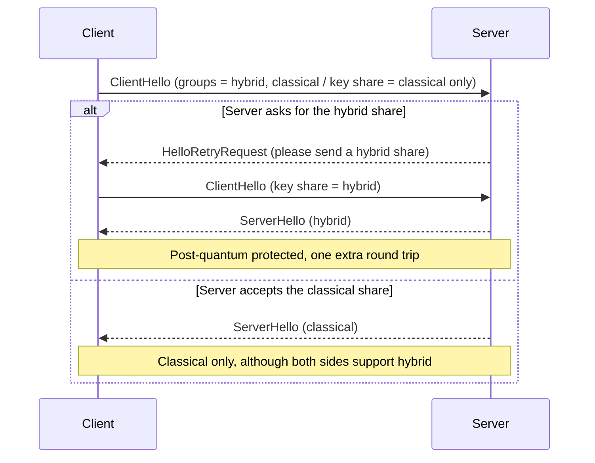
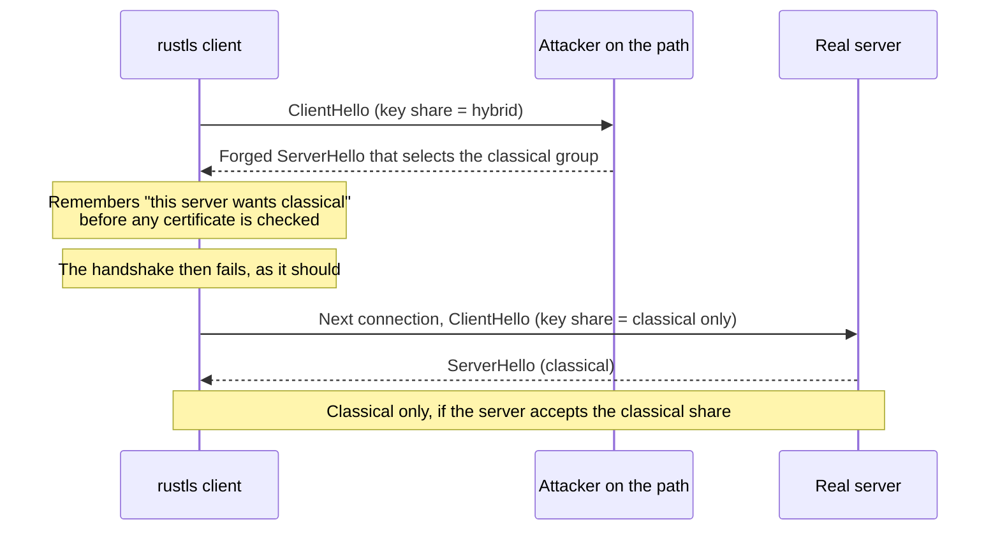
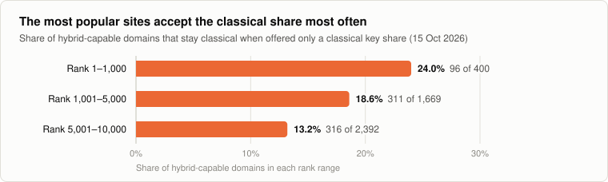
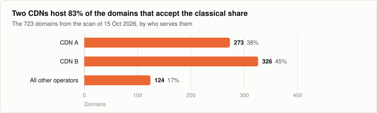

# When post-quantum TLS quietly falls back to classical

Browsers and TLS libraries have started to turn on hybrid post-quantum key exchange by default. It
combines a classical key exchange with a post-quantum one, so that traffic recorded today cannot be
decrypted later by someone who has a quantum computer.

I wanted to know whether that protection can silently disappear. If both the client and the server
support the hybrid exchange, can a connection between them still end up protected by the classical
one alone? It turns out that it can, and more often than I expected. This repository summarizes what
I found and contains the scanner I wrote to measure how common the problem is.

## A little background

When a TLS 1.3 client opens a connection, it tells the server which key-exchange groups it supports.
Separately, it sends key shares, which are the actual public keys, for only some of those groups,
because sending all of them would make the first message large.

The interesting case is a client that lists the hybrid group but sends a key share only for the
classical one. The server then has a choice. It can ask the client to try again with a hybrid share,
which costs one extra round trip (a HelloRetryRequest), or it can simply continue with the classical
share it already has. The TLS standard allows both, so what actually happens depends on which library
the server runs and how it is configured.

## What I found

**1. A downgrade bug in rustls.**
rustls is a widely used TLS library written in Rust. I found that an attacker on the network path
could send a single forged ServerHello, and the client would remember the group named in it before it
had checked any certificate. The handshake itself failed, as it should, but on later connections to
the same server name the client sent only a classical key share. I reported the problem privately to
the maintainers, who fixed it in rustls 0.23.46 and published a
[security advisory](https://github.com/rustls/rustls/security/advisories/GHSA-w44r-93j7-qv28).
The severity was rated low, and the issue was later assigned a CVE number.

**2. Many servers accept the classical share.**
To see how servers behave in practice, I scanned the Tranco top 10,000 domains. Of these, 4,461
selected the hybrid group when the client offered both key shares. When the client offered only the
classical share, 16.2% of them went ahead with classical key exchange instead of asking for the
hybrid share. I repeated the scan four times over several weeks, and the figure stayed between 15.1%
and 16.5%.

<picture>
  <source media="(prefers-color-scheme: dark)" srcset="docs/four-scans-dark.svg">
  
</picture>

The behaviour is more common among the most popular sites. Nearly a quarter of the hybrid-capable
domains in the top 1,000 accept the classical share, compared with about one in eight further down
the list.

<picture>
  <source media="(prefers-color-scheme: dark)" srcset="docs/by-rank-dark.svg">
  
</picture>

This pattern follows from where the domains are hosted. Most of them are served by just two large
CDNs, which host a larger share of the popular sites. I notified both of them, and one has since
changed its TLS library so that its servers ask for the hybrid share. I am not naming them here until
the work is published.

<picture>
  <source media="(prefers-color-scheme: dark)" srcset="docs/by-operator-dark.svg">
  
</picture>

**3. The cause lies in library defaults and configuration.**
To understand why a server would accept the classical share, I set up a local testbed with several
TLS libraries. A server behaves this way in three situations:

- it runs OpenSSL with a colon-separated group list, which tells OpenSSL to treat both groups as
  equally preferred;
- it runs an older OpenSSL release with a known bug that drops the preference order when the group
  list contains `DEFAULT`;
- it runs wolfSSL with its default settings.

**4. It already affects mail.**
Clients that send only the classical share are not hypothetical. Postfix 3.11, a common mail server,
does so by default when it delivers mail. When it connects to a server in one of the three situations
above, the connection ends up classical even though both ends support the hybrid group.

**5. Asking for the hybrid share is cheap.**
A server that asks for the hybrid share pays for it with one extra round trip. In my measurements
from our campus network this added about 55 ms on average, which is a small price for keeping the
connection post-quantum protected.

## How the measurement works

The scanner opens at most four TLS 1.3 connections to each hostname, and each one answers a different
question. Every hostname receives the first probe. The other three are sent only to servers that
selected the hybrid group in the first one.

| Probe | Groups listed | Shares sent | Question |
|---|---|---|---|
| 1 | hybrid, classical | both | Does the server support the hybrid group? |
| 2 | hybrid, classical | classical | Does it accept the classical share, or ask for the hybrid one? |
| 3 | classical, hybrid | classical | Whose preference order does it follow? |
| 4 | classical, hybrid | both | Whose preference order does it follow? |

I read each result from the recorded handshake messages instead of the client's printed summary,
because the summary does not show whether a HelloRetryRequest took place. Every connection is closed
as soon as the handshake finishes, so no request and no application data are ever sent.

For readers who know the protocol names, the hybrid group is X25519MLKEM768 and the classical one is
X25519.

## The scanner

The code is in [`scanner/`](scanner/). It is written in Python 3 using only the standard library
(mainly `asyncio`), and it uses the OpenSSL 3.5 command-line client to perform the handshakes.

Because the scanner talks to servers that I do not operate, most of the design effort went into
making it safe to run:

- **Three protocols.** It can probe web servers over HTTPS and QUIC (HTTP/3), and mail servers over
  SMTP with STARTTLS.
- **Strict load limits.** It starts at most 18 handshakes per second and sends at most four to any
  hostname. It never retries a failed probe, and it checks an opt-out list before every connection.
- **A guard in front of every run.** Before a scan starts, [`guard.py`](scanner/guard.py) checks the
  time window, the source address, the system clock, the free disk space and the hashes of the
  scanner files. While the scan runs, it keeps watching and stops it at the end of the window or when
  a stop file appears. If a run is interrupted, it can resume without probing any host twice.
- **Offline tests.** The 65 tests run inside an isolated network namespace against local test
  servers, so nothing leaves the machine. You can run them with `bash scanner/run_tests.sh`.

On a typical night the scanner completes about 230,000 handshakes to 100,000 hostnames in roughly
four hours, and it never exceeds 18 per second.

## Status

The numbers above come from the top 10,000 domains. A larger round is under way in November 2026. It
covers the top 100,000 domains, adds mail servers and QUIC, and runs from two vantage points. I
publish only aggregate numbers; results for individual hosts stay private.

## Ethics

All scans run at night, in time windows agreed in advance with the campus network operations center,
and I stop a scan at any complaint. The rustls maintainers and the two CDNs were informed before
anything was made public.

## About

Chi-Yen (Adam) Fan, National Cheng Kung University
